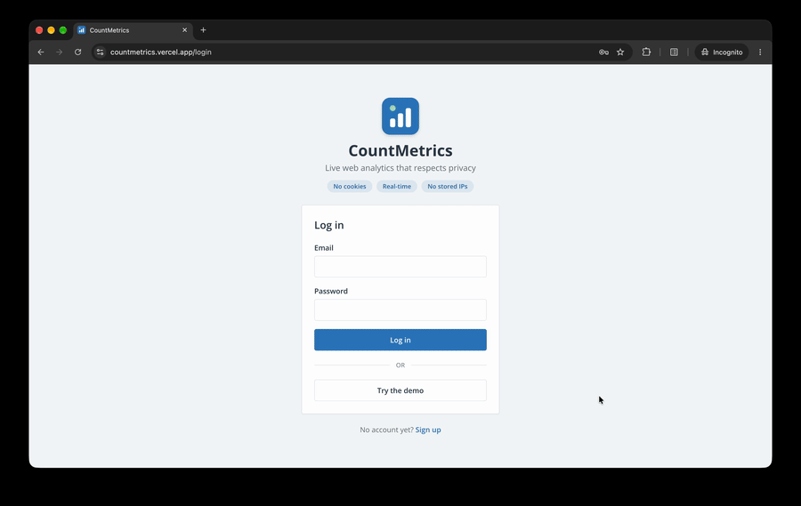
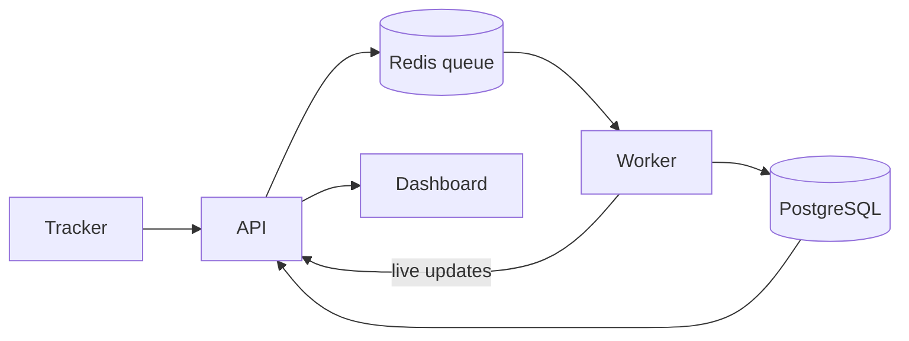

# CountMetrics

Live website stats without cookies.

**[Try the live demo](https://countmetrics.vercel.app)** (free hosting, so give it a moment to wake up)



## How it works



TypeScript, React, Fastify, BullMQ, Redis, PostgreSQL.

## Highlights

- **Fast tracking:** the API queues events, and the worker saves them in batches.
- **Privacy:** no tracking cookies, no raw IPs saved by the app, and visitor IDs change daily.
- **Load tested:** at 1000 events/s, batching cut the longest queue from 36,185 to 527. [Details](loadtest/RESULTS.md)

## Run it locally

Needs Node 20+, pnpm and Docker.

```bash
pnpm install
cp .env.example .env   # change JWT_SECRET
docker compose up -d
pnpm --filter api prisma migrate dev
pnpm --filter @countmetrics/tracker build
pnpm --filter api seed
pnpm dev               # http://localhost:5173
```

---

This product includes GeoLite2 data created by MaxMind, available from [maxmind.com](https://www.maxmind.com).
